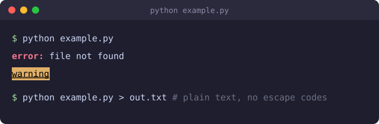

<div align="center">

# clitint

**Fast terminal text formatting for Python 3.13+, with no dependencies.**


Text is coloured only when someone is reading it on a terminal: redirect the output to a file, a pipe or a CI log
and it comes out plain.

This library is ideal for simple and very fast formatting of text on libraries and command-line tools.

```python
from clitint import formatter, create_colour

text_1 = formatter("error:", "bold_red")
text_2 = formatter("warning", "underline_black_highlight_yellow")
print(text_1, "file not found")
print(text_2)

hot_pink = create_colour("hotpink", 255, 105, 180)   # your own RGB colour, by name in any spec
print(formatter("done", f"bold_{hot_pink}"), formatter("ok", f"black_highlight_{hot_pink}"))
```

</div>


</div>


It is made for libraries and tools that build messages: one call with a short spec, an answer that follows the
environment as it is now, and colours only when **both** stdout and stderr are terminals, so an error message that
ends up in a log has no escape codes in it.


## 📦 Install

```bash
pip install clitint
```

## 🎨 Specs

A spec is a set of styles joined by `_`, in any order: `"red"`, `"bold_red"`, `"red_bold"`,
`"italic_white_highlight_blue"`.

| Kind        | Names                                                                                    |
|-------------|------------------------------------------------------------------------------------------|
| Attributes  | `bold` `dim` `italic` `underline`                                                        |
| Colours     | `black` `red` `green` `yellow` `blue` `magenta` `cyan` `white` `grey` `orange` `pink` `purple` `brown` `teal` `gold` `maroon` `navy` `olive` `coral` `lime` |
| Backgrounds | `highlight_` followed by a colour, e.g. `highlight_blue`                                 |

Combine as many attributes as you like with at most one colour and one background: `bold_highlight_blue`,
`italic_red`, `underline_green`.

- An unknown name, two colours or two backgrounds raise a `ValueError` that names the problem.
- `formatter` takes any object and writes its `str`.
- Each spec is worked out once and remembered.

### Your own colours

`create_colour` adds an RGB colour under a name of your choice, and returns that name. From then on it goes in a
spec as any colour does, alone or as `highlight_<name>`:

```python
from clitint import create_colour, formatter

steel = create_colour("steel", 70, 130, 180)
print(formatter("ok", f"bold_{steel}"), formatter("ok", f"white_highlight_{steel}"))
```

A name is one word without `_`, and not an attribute or `highlight`; each component is an int from 0 to 255.
Creating a name again with the same components does nothing, so two libraries can each create the colour they
need. Creating it with different components raises a `ValueError`.

`create_multiple_colours` makes several at once and returns their names in order. It is all or nothing: if one
is refused, none of the new ones are added.

```python
from clitint import create_multiple_colours

steel, sand = create_multiple_colours({"steel": (70, 130, 180), "sand": (194, 178, 128)})
```

### 24-bit colours

`orange` and the colours after it in the table, and every colour made with `create_colour`, are 24-bit (RGB).
`black` to `grey` work on every terminal; a 24-bit colour is written only where the terminal says it shows one:

- `COLORTERM=truecolor` or `24bit` (the convention; GNOME Terminal, Konsole and most others set it);
- Windows Terminal (`WT_SESSION`), or a `TERM_PROGRAM` of iTerm2, VS Code, WezTerm, Ghostty, Hyper or Tabby;
- a `TERM` of kitty, Alacritty, Ghostty, WezTerm or foot, or one ending in `-direct`;
- on Windows, a console that took the escape sequences.

Elsewhere the text is written **plain**, and the first time it happens a `TrueColourWarning` is raised (once per
process). When colours are forced (`FORCE_COLOR`, `turn_colours_on()`) 24-bit colours are always written.

> [!TIP]
> If your terminal shows 24-bit colour but gets the warning, set `COLORTERM=truecolor`. To silence it:
> `warnings.simplefilter("ignore", clitint.TrueColourWarning)`.

## 🖥️ When text is coloured

`formatter` decides at every call, in this order:

| # | Condition                                                          | Result    |
|---|--------------------------------------------------------------------|-----------|
| 1 | `turn_colours_off()` / `turn_colours_on()` was called              | as chosen |
| 2 | `NO_COLOR`, `ANSI_COLORS_DISABLED` or `CLITINT_COLOURS_OFF=1`      | plain     |
| 3 | `FORCE_COLOR`                                                      | coloured  |
| 4 | `TERM=dumb`                                                        | plain     |
| 5 | otherwise                                                          | coloured only when **both** stdout and stderr are terminals |

`let_the_environment_decide()` undoes rule 1, and `colours_on()` tells you the answer now.

`NO_COLOR` and `FORCE_COLOR` count when they are set to anything but an empty string, as
[no-color.org](https://no-color.org) and [force-color.org](https://force-color.org) say (`FORCE_COLOR=0` forces too).
On Windows 10 and 11 the console is asked to read escape sequences; where it can't, text is plain unless forced.

> [!TIP]
> **Why both streams?** A string doesn't know where it is going: an error message might be printed, logged or
> raised. With `2> errors.log` and stdout on a terminal you still get a plain message, so no escape codes end up in
> the log.

## 🧰 Other tools

### Switching colours from the program

```python
from clitint import turn_colours_off, turn_colours_on, let_the_environment_decide, colours_on

turn_colours_off()              # plain from now on, whatever the environment says (a --no-color flag)
turn_colours_on()               # coloured from now on, even into a file or a pipe (a --color flag)
let_the_environment_decide()    # back to the rules above
colours_on()                    # the answer right now: True or False (inside one_decision, the answer kept)
```

### Building one message: decide once

Every `formatter` call checks the environment and the streams. That is the only real cost this library has, and
it is insignificant for most uses. But when a message is built from many pieces (hundreds or thousands of
`formatter` calls), it adds up. `one_decision` checks once for the whole block, and is many times faster there.

```python
from clitint import formatter, one_decision

with one_decision() as on:          # `on`: the answer, True or False
    line = formatter("a", "red") + " " + formatter("b", "blue") + " " + formatter("c", "green")
```

Inside the block, `colours_on()` gives the same answer. Blocks can be nested, and an inner one keeps the outer answer. Something that changes the answer inside the
block, such as `turn_colours_off()`, takes effect only after the block ends. The answer lives in a module global,
so don't build messages in several threads at once.

`decide()`, `decision()` and `release()` do the same without a `with` block, for a library that wraps its own
message building:

```python
from clitint import decide, decision, release

decide()        # check now and keep the answer (returns it)
decision()      # the answer kept, or None if nothing is decided
release()       # forget it: each formatter call checks again
```

### Raw escape sequences, for hot loops

`escapes` gives the sequences that go before and after the text, two per spec, in one flat tuple. They are the
same whether colours are on or not, and a 24-bit colour is not checked against the terminal, so ask
`colours_on()` yourself:

```python
from clitint import escapes, colours_on

red, reset, bold, bold_reset = escapes("red", "bold")
text = f"{red}x{reset}" if colours_on() else "x"
```

`ATTRIBUTES`, `COLOURS` and `BACKGROUNDS` are read-only views of the names and their sequences (`create_colour`
is the way to add one), and `ESC` is the reset sequence (`"\x1b[0m"`).

### Removing colours

```python
from clitint import strip_colours

strip_colours(formatter("x", "red"))   # 'x': every ANSI style sequence removed (for tests and logs)
```

### For a library built on clitint

Give your users an off switch of their own, next to `CLITINT_COLOURS_OFF`:

```python
from clitint import add_off_switch

add_off_switch("MYLIB_COLOURS_OFF")    # MYLIB_COLOURS_OFF=1 now turns colours off too
```

Only the value `1` counts, and it is checked together with the other off switches, before `FORCE_COLOR`.

## 📄 Licence

MIT
